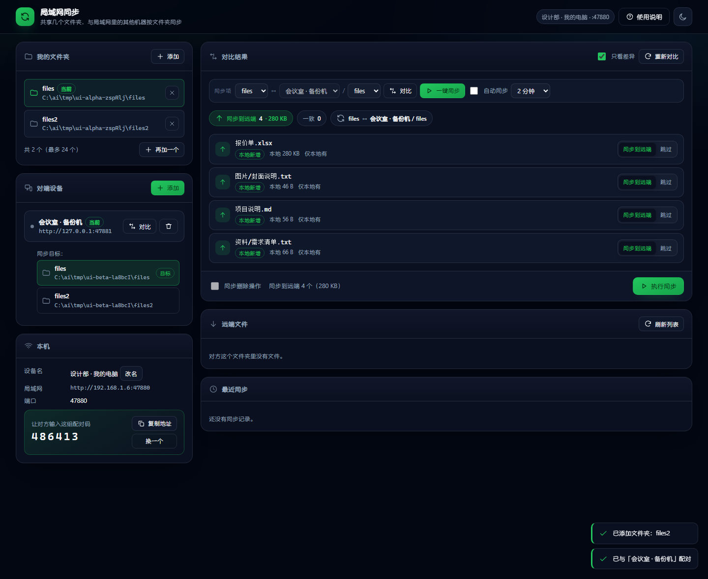
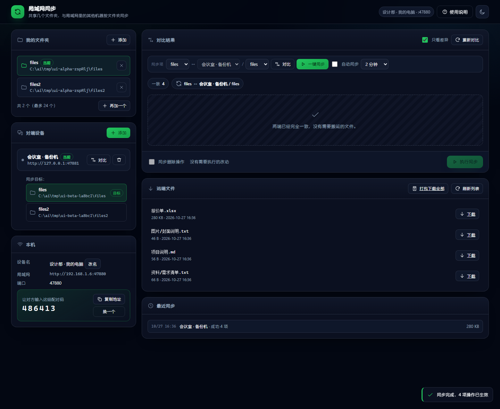
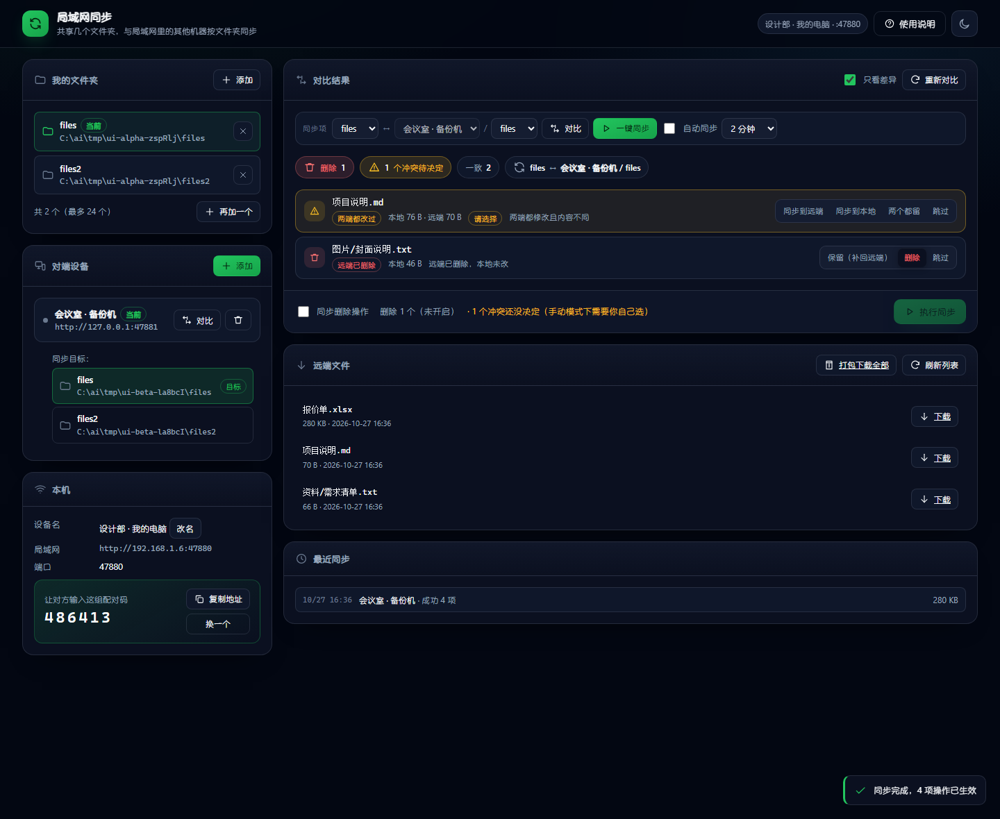
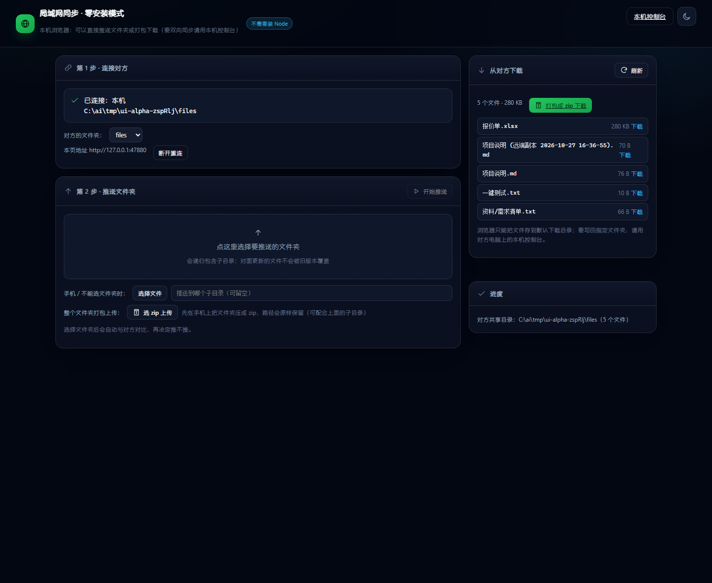
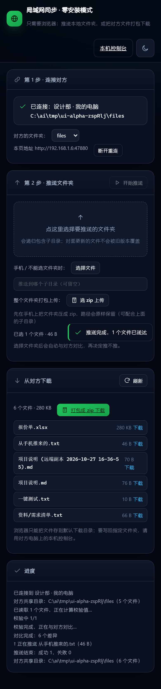

# Communication · 局域网文件夹同步

[](LICENSE)
[](https://nodejs.org)
[](test)
[](android)

> **国内镜像**：[gitee.com/yingying-monster-elite/lan-folder-sync](https://gitee.com/yingying-monster-elite/lan-folder-sync)
> —— GitHub 访问不畅时走这个；代码与 GitHub 一致，更新后在 Gitee 仓库页点一次「强制同步」即可。

把几个文件夹共享出来，和同一局域网的另一台电脑（或手机）按"文件夹对文件夹"同步。
**双向同步、冲突由你决定、删除默认关闭**；**零第三方依赖**，桌面端只要 Node.js 20+ 就能跑，
也可以直接用打好的免安装包；手机端是原生 App，**能选整个文件夹**。

不联网、不上云、不经过任何服务器——两台设备直接在这条局域网里对话。

| 对比结果 | 远端文件（自由下载） |
| --- | --- |
|  |  |

## 三种用法

| 想要 | 用哪个 | 需要装什么 |
| --- | --- | --- |
| 电脑 ↔ 电脑，双向同步 | 桌面端（便携版或 `启动.bat`） | 无（便携版自带 Node） |
| 电脑 ↔ 手机，双向同步 | 桌面端 + 安卓 App | 装一个 APK |
| 只想把文件推过去 / 拉下来 | 浏览器打开 `http://对方IP:47800/lite` | 什么都不用装 |

## 快速开始

**Windows 免安装版**：解压 `Communication-win-x64.zip` → 双击 `Communication.exe` → 点「打开界面」。
（自己打包：`powershell -ExecutionPolicy Bypass -File packaging/build-app.ps1`）

**从源码跑**：

```bash
git clone https://github.com/RemielDan-AI/lan-folder-sync.git
cd lan-folder-sync
npm start
```

或双击 `启动.bat`。会打印本机地址与配对码，并自动打开浏览器控制台。

**另一台电脑**，两种方式任选：

| 方式 | 做法 | 能做到 |
| --- | --- | --- |
| 完整节点 | 把这个文件夹整个拷过去（或用便携版），双击启动 | 双向同步、冲突选择、删除同步（推荐） |
| 零安装 | 浏览器打开 `http://对方IP:47800/lite` | 单向推送文件夹/压缩包、打包下载对方文件 |

> macOS / Linux：`./start.sh` 或 `node server.js`。
> 手机端：`adb install -r android/out/commsync-mobile.apk`，详见 [android/README.md](android/README.md)。

## 为什么是"手动点按钮"

自动监听文件变化看起来很美，代价是：传了半个文件、把临时文件当正式文件同步、两台机器同时改同一处时悄悄覆盖。
这里刻意做成 **对比 → 看清楚 → 执行** 三步：你永远知道下一步会发生什么。
（真想要自动化，同步项上可以开「自动同步」，按间隔跑，冲突按修改时间裁决、旧版本存副本。）

## 目录结构

```
server.js            HTTP 路由、任务编排、SSE、自动同步调度
lib/                 配置存储 / 差异执行 / 传输 / 对端调用 / zip / 解包 / 路径安全
shared/              前后端共用的纯逻辑（差异引擎、纯 JS SHA-256）
public/              桌面端界面（原生 ES 模块，无框架）
android/             安卓 App（Kotlin，无 AndroidX），含 PeerServer 对端服务
packaging/           Windows 便携版打包（C# 启动器 + 内置 node.exe）
test/                72 项测试（node:test）
docs/PROTOCOL.md     对端协议与同步状态机
```

## 多个文件夹怎么组织

每台机器都可以添加**多个**共享文件夹（最多 24 个），它们互不干扰：

- 「我的文件夹」点「**添加**」→ 选目录；重复添加同一路径会自动去重；行尾 `×` 只是取消共享，**不会删文件**。
- 每加一个，都会出现在「对比结果」顶部的 **同步项** 选择条里。

**一个同步项 = 本机某个文件夹 ↔ 某台对端 / 对方的某个文件夹**。
所以 A 的「资料」可以只和 B 的「共享区」同步，A 的「照片」和 B 的「照片备份」同步，两条线各自有独立的"上次同步到哪"的记忆（基线），不会串味。

```
同步项  [资料 ▾]  ↔  [会议室·备份机 ▾] / [共享区 ▾]   [对比]
```

切换同步项会自动作废旧对比结果，避免把 A 的对比结果执行到 B 上。

## 两台电脑怎么配对

1. A、B 两边各自在「我的文件夹」里点「添加」，把要共享的文件夹加进来（可以加多个）。
2. A 的界面点「对端设备 → 添加」，填 **B 的地址**（B 控制台「本机」卡片里的 `http://192.168.x.x:47800`）和 **B 的配对码**（6 位数字）。
3. 配对一次即可：双方交换令牌，之后 A、B 都能主动发起同步。
4. 在「同步项」里选好 **本机文件夹 / 对端 / 对方文件夹**，点「对比」。

配对码是这台机器的凭证，随时可以在「本机」卡片点「换一个」失效重发。对方共享了哪些文件夹，在「对端设备」卡片里直接列出来，点一下就是把它设为同步目标。

## 一次同步长什么样

点「对比」只做检查，**不改任何文件**。结果分成几类，每条都能单独改方向或跳过：

| 显示 | 含义 | 默认动作 |
| --- | --- | --- |
| 本地新增 / 本地已修改 | 本机有、对方没有或更旧 | 同步到远端（用本机这份覆盖对方） |
| 远端新增 / 远端已修改 | 对方有、本机没有或更旧 | 同步到本地（用对方那份覆盖本机） |
| 远端已删除 | 对方删了，本机没动过 | 删除本机（需开启删除） |
| 本地已删除 | 本机删了，对方没动过 | 删除远端（需开启删除） |
| 两端都改过 | 两端都动过同一个文件 | **冲突，必须你选** |
| 一致 | 内容相同 | 跳过 |

> 这里的按钮写的是「**同步到远端 / 同步到本地**」，不是"上传/下载一个文件"：
> 它决定的是**以哪一边为准把两边同步成一样**，另一边会被覆盖。想单纯"拿一份对方的文件、不参与同步"，用下面的「远端文件」。

确认无误后点「执行同步」，底部会显示实时进度与逐文件结果。执行完会自动再对比一次，确认是否收敛。

## 远端文件：直接下载，不参与同步

右下角「**远端文件**」卡片列出对方文件夹里的所有文件（路径 / 大小 / 修改时间），每行一个「下载」按钮，
右上角还有「打包下载全部」（边拉边打包，不落临时文件）。

- **只下载**：文件存进浏览器的下载目录，**不写进本机的同步文件夹、不进基线**，所以不会影响下一次对比；
- 清单来源：点「对比」时会顺带取到；也可以点「刷新列表」单独拉一次；
- 想整包拿走（比如手机相册整个目录），用「打包下载全部」，得到一个标准 zip，Windows/macOS/7-Zip 都能直接解开。


## 一键同步 与 自动同步

同步项选择条上有三个动作：

| 动作 | 行为 |
| --- | --- |
| **对比** | 只检查，不改文件 |
| **一键同步** | 对比 + 直接执行，一次点完；**遇到冲突会停下来**，把计划显示出来让你选，绝不擅自覆盖 |
| **自动同步**（开关 + 间隔） | 服务端定时跑"对比 + 执行"，**关掉浏览器照样跑**；间隔可选 30 秒 / 1 分钟 / 2 分钟 / 5 分钟 / 15 分钟 |

自动同步是**按同步项**开启的（不是全局），换到别的文件夹对就互不影响。它有两个固定约束，避免半夜出事：

- **不删文件**（删除操作永远需要你手动确认）。
- **冲突按修改时间自动裁决**：较新的那份成为两端正式版本，较旧的那份自动另存为
  `文件名 (本地副本 2026-10-27 11-00-00).扩展名` / `(远端副本 …)`，两边内容最终一致、两份都不丢。
  如果两边的修改时间差不到 1 秒（分不清谁新），它不会瞎猜，会留着等你手动处理。

自动同步改动过文件后，界面上那份对比结果会标记为"已过期"，需要重新对比才能执行——避免拿旧清单覆盖新状态。

## 冲突怎么处理

这里有个刻意的区别：**手动操作永远让你自己选，自动同步才按时间裁决**。

手动对比 / 手动下载 / 一键同步时，同一个文件两端都改过会给三个选项：

- **保留本地**：本机版本覆盖到对方。
- **保留远端**：用对方版本覆盖本机。
- **两个都留**：本机版本成为两端的正式版本，对方那一版自动另存为
  `文件名 (远端副本 2026-10-26 10-30-00).扩展名`，并把这份副本也同步到本机。
  两个版本都还在，两边内容也完全一致。

自动同步时（没人看着），冲突改为按修改时间处理：**较新的留下，较旧的自动存成副本**。
一边删除一边修改也算冲突——删除没有"修改时间"可比，这种一律**保留还在的那份文件**，先别丢东西。



## 删除为什么要单独开闸

删除不进回收站，是不可撤销的。所以「同步删除操作」默认不勾选：即使对比结果里有删除项，不勾就不会删。
勾选后点执行，还会再弹一次确认框。

## 传输是怎么保证不坏的

- 每个文件比对 **SHA-256**，发送方声明、接收方校验，对不上直接判失败，不会留下错误内容。
- 下载先写 `.part` 临时文件，校验通过才改名覆盖；中断不会毁掉原文件。
- 文件修改时间随内容一起传递，所以两端"签名"一致，下次对比可以秒过（不重复读盘）。
- 基线（上次同步完成时的状态）存在 `data/baselines/`，用来区分"对方删了这个文件"和"我这边新加了文件"——这是单向盲同步做不到的事。

## 端口与防火墙

- 默认端口 **47800**（被别的程序占用时才顺延，启动时会打印实际端口和原因）。
- **同一个数据目录只会跑一个实例**：上一个终端没关又双击了一次启动，新进程会检测到已有实例，
  直接把浏览器指过去然后退出——不会再在 47801/47802 上起第二个，端口也不会"只加不降"。
  想换端口就先把旧实例关掉（关终端窗口即可），再启动会回到 47800。
- 自动发现用 UDP **47801** 广播；被防火墙挡住也不影响使用，手动填地址即可。
- Windows 首次启动如果弹出防火墙提示，请允许"专用网络"访问，否则另一台电脑连不上。
- 跨网段 / 需要走公网时，别直接暴露到公网：本工具面向可信局域网，令牌在 HTTP 明文里传输。

## 零安装模式

局域网里那台没装 Node 的电脑，用浏览器打开 `http://对方IP:47800/lite`，输入对方配对码后可以：

- **推送文件夹**：选一个本地文件夹，对比后把新增/修改的文件推过去（冲突可逐个选择"跳过"或"用我的覆盖"）。
- **推送单个文件**：手机上没法选整个文件夹时，用「选择文件」多选，可选填"子目录前缀"来保留分类。
- **上传压缩包**：手机先把文件夹压成 zip，选「选 zip 上传」，服务端会解开并把目录结构原样保留（`../` 之类的越界条目会被丢弃）。
- **选择对方的文件夹**：对方共享了多个文件夹时，页面顶部有下拉可以切换目标目录。
- **下载文件**：逐个下载，或整个共享目录打包成 zip（流式打包，不占内存）。

浏览器安全模型不允许网页在没有 HTTPS 的局域网上申请"写入任意文件夹"的权限，所以零安装模式的下载只会落到浏览器下载目录。要真正双向写入指定文件夹，请用完整节点。



## 手机能用吗

两条路：**装原生 App（能选文件夹、能双向）**，或者**用浏览器（零安装，但只能推文件/传 zip）**。

### 路线 A：原生 App（推荐，能选整个文件夹）

源码和构建脚本在 [`android/`](android/README.md)，现成安装包在 `android/out/commsync-mobile.apk`。

- 用安卓 SAF 的目录选择器**选整个文件夹**，授权永久保存，之后可以直接读写里面的文件；
- 和电脑配对后可**双向同步**，冲突逐条选择（保留本地 / 保留远端 / 两个都留 / 跳过）；
- 删除默认关闭；一键同步可用；暂不支持定时自动同步。

```bat
adb install -r android\out\commsync-mobile.apk
```

> **同步方向**：手机 App 既是客户端也是服务端（内置服务，默认端口 47820），
> 所以两种情况都成立：
> - 手机发起：手机「对方共享的文件夹」里选电脑的目录 → 对比/一键同步；
> - **电脑发起**：电脑端「同步项」里选手机的目录 → 对比/一键同步（手机 App 需要在前台）。
>
> 从旧版升级后要在手机上**重新配对一次**（把手机的端口和访问令牌交给电脑），否则电脑仍然读不到手机。

### 路线 B：浏览器零安装（不用装任何东西）

手机连同一个 Wi-Fi，打开 `http://电脑IP:47800/lite`，输入电脑界面上显示的 6 位配对码即可。

| 手机能做的 | 说明 |
| --- | --- |
| 浏览 / 下载电脑上的文件 | 逐个下载，或整个共享目录打包成 zip（存到手机的"文件"或下载目录） |
| 把手机里的文件推到电脑 | 点「选择文件」多选，文件落到电脑的共享目录；可填"子目录前缀"分类 |
| **把整个文件夹传到电脑** | iOS/安卓都支持：在手机上把文件夹压成 zip → 「选 zip 上传」，目录结构会保留 |
| 选整个文件夹直接推送 | 只在不降级的浏览器上有效（见下），不行就用上面两条 |

**关于安卓能不能选文件夹**：`webkitdirectory` 这个能力在安卓 Chrome 里"存在但不可靠"——属性是支持的，
但系统文件选择器多数情况下给不出目录，会退化成"选文件"。不同机型 / 版本表现不一致，所以别指望它。
真想选目录就用上面的原生 App。

为避免"以为选了文件夹、其实文件全被摊平到根目录"，零安装页会**检测这种降级**：一旦发现拿到的文件没有相对路径，
会明确提示"当前浏览器不支持直接选文件夹，已按平铺处理；保留目录请用 zip 上传"。真正稳妥的方式始终是压 zip。

| 浏览器版做不到的 | 原因 |
| --- | --- |
| 当完整同步节点（双向写回指定文件夹） | 浏览器安全模型：纯 HTTP 的局域网页面拿不到"写入任意文件夹"的权限；要双向同步请装原生 App 或用电脑端 |
| 打开电脑上的主控台 | 主控台只允许在 127.0.0.1 打开，因为它能改本机文件夹；手机上访问会引导到零安装页 |

手机端的行为差异：不保存"上次同步到哪"，每次推送前都会重新对比一遍；两端都改过的文件会显示成冲突、默认跳过，可以手动选"用我的覆盖"。

> 技术上有个坑值得记一笔：`crypto.subtle` 只在安全上下文（https 或 localhost）存在，手机经 `http://192.168.x.x` 访问时根本没有它。
> 所以零安装页的内置校验用的是 `shared/sha256.js` 里的纯 JS 流式 SHA-256（有 `crypto.subtle` 时优先用它），否则手机上一点推送就会失败。



## 数据与安全

项目目录下的 `data/`：

| 文件 | 内容 |
| --- | --- |
| `config.json` | 设备 ID / 名称 / 端口 / 配对码 / 管理员令牌 / **共享文件夹列表** |
| `peers.json` | 已配对设备与双向令牌 |
| `baselines/*.json` | **每个同步项一份**"上次同步完成时"的状态（文件名里带着对端 + 两个文件夹的 id） |
| `history.json` | 最近 30 次同步记录（只看不用） |

删掉 `data/` 等于忘记所有配对与同步记录，**不会动你的任何文件**。
所有网络请求都会做路径越界检查（`../`、绝对路径一律拒绝），解压也会丢弃越界条目，对端只能读写被共享的那些文件夹里的内容。
从 1.0 升级上来时，原来那单个文件夹会自动迁移进新的文件夹列表，不用重新选。

## 命令行参数（环境变量）

| 变量 | 作用 |
| --- | --- |
| `LAN_SYNC_PORT` | 指定端口（默认 47800） |
| `LAN_SYNC_DATA` | 指定数据目录（默认 `./data`） |
| `LAN_SYNC_NO_BROWSER=1` | 启动后不自动开浏览器 |
| `LAN_SYNC_DISCOVERY=0` | 关闭 UDP 自动发现 |

## 给维护者

```
server.js          HTTP 服务：静态页面 + 本机 API + 对端 API + SSE 进度
shared/diff.js     差异引擎（纯函数，Node 与浏览器共用的同一份判定逻辑）
shared/sha256.js   纯 JS 流式 SHA-256（非安全上下文里替代 crypto.subtle）
lib/engine.js      扫描编排 + 执行器 + 基线回写（按同步项隔离）
lib/manifest.js    目录遍历、签名、按需哈希
lib/transfer.js    流式收发、哈希校验、原子落盘
lib/peer-api.js    对端 HTTP 调用（统一超时与错误）
lib/config.js      文件夹列表/对端/基线/历史的持久化（原子写）
lib/net.js         局域网地址、端口探测、UDP 发现
lib/zip.js         存储模式 ZIP 流式打包
lib/unzip.js       ZIP 解包（流式 inflate + zip 穿越防护）
lib/safe-path.js   路径越界防护
public/            控制台界面、零安装页
```

跑测试：

```bash
npm test                      # 63 项：差异 32 + SHA-256 4 + 打包 2 + 解包 4 + 端到端 21
node scripts/ui-smoke.mjs     # 真实浏览器跑完整交互并截图（需本机有 Chrome/Edge）
```

`test/e2e.test.mjs` 会起两个真实实例互相同步，覆盖配对、双向、删除开关、冲突"两个都留"、反向发起、多文件夹隔离、打包下载、压缩包上传与 zip 穿越、**一键同步遇冲突会停下**、**自动同步按修改时间裁决并留副本**。
`scripts/ui-smoke.mjs` 用 CDP 驱动真实 Chrome：界面里连续加两个文件夹、配对、对比、切换同步项、执行、冲突"两个都留"、删除二次确认、**一键同步**、**自动同步开关**、手机尺寸下经局域网 IP 推送文件与上传 zip（真实非安全上下文），并断言界面上没有错误提示。

## 已知限制

- 只同步**文件**，不保留空文件夹。
- 跳过符号链接（避免目录环与越界）；跳过 socket / 设备文件。
- 以文件大小 + 修改时间作为快速签名，理论上"大小与时间都没变但内容变了"的修改要等下次内容变化才被发现（`touch` 一下即可触发）。
- 打包/解包都不支持超过 4GB 的条目（zip64 未实现），会明确报错而不是产出坏包。
- 自动同步只在**这台机器开着本工具**时运行（服务端定时器），关机 / 没启动就不跑。
- 没有增量块传输（rsync 式）；大文件改一点也要整份重传。
- 同一个同步项同一时刻只建议一台机器发起：两端同时点执行时，冲突判定仍然是"谁先落盘谁生效"，但不会损坏文件（每份写入都校验哈希）。
- 手机端的内置服务（端口 47820）只在 App 处于前台时监听；锁屏久了会被系统冻结，电脑端扫描会超时，切回前台即可。
- 只面向**可信局域网**：令牌是明文 HTTP 传输，不要把这个端口暴露到公网。

## 参与开发

见 [CONTRIBUTING.md](CONTRIBUTING.md)。协议细节（接口、鉴权、配对、同步状态机）见 [docs/PROTOCOL.md](docs/PROTOCOL.md)。

```bash
npm test                                  # 72 项：单测 + 端到端 + 对端协议
node scripts/ui-smoke.mjs                 # 真实浏览器冒烟测试
cd android && gradlew.bat testDebugUnitTest assembleDebug
powershell -ExecutionPolicy Bypass -File packaging/build-app.ps1
```

## 许可

[MIT](LICENSE)。随便用、随便改，出事别找我。

